<p align="center">
  
</p>

# 🖼️ Image-Caption-Generator-ICG

🚀 **App Development Report**

📌 **Project Overview**

The project is an Image Captioning application that utilizes a pre-trained model to generate captions for images. The application is developed using Streamlit for the frontend and TensorFlow for the machine learning model.

📂 **Project Structure**

- 📄 `app.py`: The main application file that contains the Streamlit code for the frontend.
- 🧠 `model.py`: Contains the model definition and functions for loading and generating captions.
- 📜 `requirements.txt`: Lists all the dependencies required for the project.

🔑 **Key Components**

1. 🎨 **Streamlit Frontend (`app.py`)**
    - Provides an interface for users to input an image URL or upload an image.
    - 🖼️ Displays the image and generates captions using the pre-trained model.

2. 🏗️ **Model Definition (`model.py`)**
    - Defines the CNN Encoder using InceptionV3.
    - Implements a Transformer-based encoder and decoder.
    - Loads the pre-trained model weights and generates captions for input images.

📦 **Dependencies**

The project requires the following dependencies:

- 📊 `pandas`
- 📜 `pandas_stubs`
- 🖼️ `Pillow`
- 🌐 `requests`
- 🎛️ `streamlit`
- 🔧 `pip==24.3.1`
- 🤖 `tensorflow==2.9.1`
- 🔢 `numpy<2.0`

These dependencies are listed in the `requirements.txt` file.

▶️ **How to Run the Application**

⚙️ **Prerequisites**

- 🐍 Python 3.7 or higher
- 🔄 Virtual environment (recommended)

🛠️ **Steps to Run**

1. 📥 **Clone the Repository**

    ```bash
    git clone https://github.com/your-repo/image-caption-generator-icg.git
    cd image-caption-generator-icg
    ```

2. 🏗️ **Create and Activate a Virtual Environment**

    ```bash
    python -m venv venv
    source venv/bin/activate  # On Windows use `venv\Scripts\activate`
    ```

3. 📦 **Install Dependencies**

    ```bash
    pip install -r requirements.txt
    ```

4. 🚀 **Run the Application**

    ```bash
    streamlit run app.py
    ```

5. 🌐 **Access the Application**

    Open your web browser and go to `http://localhost:8501` to access the Streamlit application.

🛑 **Troubleshooting**

- ❌ **Non-zero exit code on installation**:
  Ensure that all dependencies are correctly listed in `requirements.txt` and that there are no typos.

- 🛠️ **TensorFlow issues**:
  Ensure that TensorFlow is compatible with your Python version and that you have the necessary system dependencies installed.

By following these steps, you should be able to run the Image Captioning application and generate captions for your images successfully. 🎉

**App Demo**: [https://azmi-image-caption-generator-icg.streamlit.app/](https://azmi-image-caption-generator-icg.streamlit.app/)
